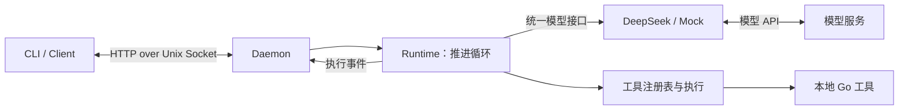

# 第一版 ReAct 工具循环

日期：2026-10-22。状态：get_time、有限循环、模型消息接口、DeepSeek 流式工具调用和本地协议 v2 已实现。使用与源码讲解见 [第四课](../learning/04-react-loop.md)。文件读取、跨 turn 历史与持久化仍是后续步骤。

目标：在现有 CLI → Daemon → Runtime → DeepSeek 链路中，让一次用户请求能够经历多次模型调用和工具执行，直到形成回答或触及明确的限制。

## 1. 第一个可以看到的结果

先加入 `get_time` 工具，接受可选的 IANA 时区（默认 `Asia/Shanghai`），输出当前时间和时区。默认值是本阶段的显式产品约定，不依赖电脑当前所在时区。单元测试注入固定时钟，避免使用真实当前时间作为断言。

例如用户问“调用工具查询上海现在的时间，并用一句话告诉我”：

1. Runtime 把 system 指令、用户消息和工具定义交给模型。
2. 模型返回 `get_time` 调用和参数。
3. Runtime 校验并执行本地 Go 函数。
4. Runtime 将工具结果加入当前消息列表，再次调用模型。
5. 模型生成回答，Runtime 宣告本次执行完成。

一次请求允许直接回答，也允许多次工具往返。是否调用工具由模型选择；离线脚本式 Provider 用于确定性验证循环和边界，真实模型用于少量人工验收。

后续再加入 `list_files` / `read_file`，验证“列目录 → 选文件 → 阅读 → 回答”的连续行动。届时单独落实工作区根目录、符号链接、目录逃逸、文件类型和输出限制。

## 2. Turn、模型轮次和消息

- 一个 turn：一次用户请求到完成、失败或取消的全过程。沿用当前一个 `run_id` 标识本次执行。
- 一个模型轮次：调用一次 Provider，得到一个完整的 assistant 消息。
- 一个工具调用：执行 assistant 消息中的一个 tool call。同一模型轮次可能请求多个工具。
- 一个 session：跨 turn 的会话标识。当前仍只有准入用途。

本阶段的 `messages` 是 `Runtime.Run` 内的局部工作记录。每轮追加 assistant 消息和对应的 tool 结果，供下一轮模型使用。它不会写入共享 Runtime 字段，因此多个 session 不共享消息。请求结束后不保留跨 turn 记忆。

工具循环需要单次 turn 内的工作记录；跨 turn 历史和 SQLite 持久化可以在循环跑通后接入。

## 3. 架构与依赖



Daemon、Runtime、Provider 和工具都位于同一个服务进程中。Runtime 通过普通函数调用工具，首版串行执行，无需为循环另起服务或 goroutine。

| 模块 | 职责 |
|---|---|
| `cmd/rosetta` | 解析参数，构造 Provider、工具注册表和 Runtime，显示事件 |
| `client` | 本地 HTTP 通信、事件完整性校验 |
| `daemon` | 请求校验、session 单写、全局并发、总超时、run ID 与事件序号 |
| `agent` | 维护本次 messages、请求模型、调度工具、判断继续和终止 |
| `llm`（新增） | Provider 中立的消息、工具调用、工具说明、请求、响应和接口 |
| `provider` | 把统一模型类型转换为 DeepSeek 协议，解析完整结果 |
| `tool`（新增） | 已注册工具的查找、参数校验、执行和结果 |
| `protocol` | CLI 与 Daemon 的本地请求和显示事件 |

建议目录：

```text
internal/
  agent/runtime.go
  llm/types.go
  provider/deepseek.go
  provider/mock.go
  tool/registry.go
  tool/time.go
  protocol/types.go
  daemon/...
  client/...
```

依赖原则：`llm` 不导入具体 Provider；`provider` 不调工具、不导入 agent；工具不导入 Daemon。入口组装具体实现。API 消息和 CLI 事件是两种数据，分别建模，不能把 NDJSON 事件历史直接作为模型 messages。

## 4. Provider 接口如何演进

当前接口只有 `Stream(ctx, message string, emitText) error`。计划改成下面的形状（说明用途的接口草案）：

```go
type Provider interface {
    Name() string
    Stream(ctx context.Context, req Request,
        onText func(string) error) (Response, error)
}

type Request struct {
    Messages []Message
    Tools    []ToolSpec
}

type Response struct {
    Message Message // 完整 assistant 消息，包含文本和工具调用
}
```

`Message` 表达 role、content、tool_calls 和 tool_call_id；`ToolCall` 表达 ID、名称、JSON 参数；`ToolSpec` 表达名称、描述和参数 schema。这些类型放在 `llm`。供应商的 HTTP、SSE、finish_reason 和原始错误留在适配器内部。

流式文本通过 `onText` 尽早展示；完整的 assistant 消息通过返回值供 Runtime 追加上下文。两者是同一轮生成的两种用途，不重复发送给模型。

Provider 需要在成功返回前完成：

- 聚合同一工具调用的参数片段，检查完整 ID、工具名与参数编码。
- 区分正常文本结束与工具调用结束；工具调用轮允许没有文本。
- 只有完整、合法的结束才成功；断流、输出耗尽、异常结束都返回错误。
- 对多个工具调用按供应商提供的索引独立聚合，保持顺序。

Runtime 仅在该轮 Provider 成功返回后执行工具。半截参数、尚未结束的流不会触发本地执行。首版沿用非思考模式和结构化工具调用，不增加对 `Thought:` / `Action:` 文本的解析。

## 5. 工具是什么

工具是一段本地 Go 实现，加上模型可读的名称、描述和参数 schema。

工具接口可以从两个能力开始：返回说明 `Spec()`；执行 `Execute(ctx, arguments)`。注册表使用名称查找工具，并确保名称不重复。

模型只会请求调用工具。真正的执行权在 Runtime 和工具执行代码中：

1. 检查工具是否在已注册集合内。
2. 检查参数 JSON 只有一个对象，字段、类型和值有效。
3. 检查本次调用和整体预算。
4. 在工具 context 下执行。
5. 控制输出大小，把成功或业务错误组织为工具结果。

首版只有一个简单 schema，不引入通用 JSON Schema 校验框架。schema 帮助模型生成参数，Go 校验负责决定是否执行。

未知工具、非法参数、业务失败可以作为 `is_error: true` 的工具结果回给模型，使它修正请求。取消、总超时、事件写入失败、协议破损和循环预算耗尽结束整个 turn。

工具结果中的 `is_error` 是我们放进 content 的应用数据，不假设供应商提供同名消息字段。原始内部错误、凭证与日志信息不直接作为工具结果返回。

## 6. 消息必须正确配对

工具执行之后，下一次模型请求包含：

```text
system:    助手职责、工具使用约定
user:      查询上海当前时间
assistant: tool_calls=[{id: call_1, name: get_time, arguments: ...}]
tool:      tool_call_id=call_1, content=工具结果
```

随后模型可能生成最终回答，也可能请求下一批工具。

必须保留 assistant 工具调用消息，并为每个调用追加且只追加一个对应的 tool 结果，不能只把工具结果拼成普通 user 文本。缺失或重复调用 ID 视为不合法模型响应。

同一轮多个调用先整体检查数量和剩余预算，再按顺序执行；全部结果加入 messages 后才进入下一轮。首版不引入并行工具调度。发生取消时停止处理，局部记录随 turn 结束而释放，不发起下一轮模型请求。

## 7. 循环与终止

```text
创建本次 messages
发送 turn.started

循环，最多 6 次模型调用：
    检查取消和输入预算
    发送 model.round.started
    调用 Provider，转发文本增量
    Provider 完整成功后，检查 assistant 消息
    将 assistant 消息追加到 messages

    如果没有工具调用且有有效回答：
        发送 turn.completed，返回成功

    检查还有下一轮模型额度、工具数量和调用预算
    依次执行工具：
        发送 tool.started
        校验、执行、整理结果
        将结果追加到 messages
        发送 tool.finished

达到限制：返回明确错误，由 Daemon 发送 turn.failed
```

最后一个模型轮次如果仍请求工具，直接报告轮次耗尽，避免执行完工具却没有额度让模型读取结果。工具完成本身不代表整个 turn 完成；仍需模型根据结果作答。

起步限制是本阶段可调整的工程默认值：

| 限制 | 初始值 |
|---|---|
| 每个 turn 的模型调用数 | 6 |
| 每个 turn 的工具调用数 | 8 |
| 单轮工具调用数 | 4 |
| turn 总超时 | 沿用 2 分钟 |
| 单次工具执行超时 | 3 秒 |
| 单个工具结果大小 | 8 KiB，截断需显式标识 |
| 模型输入 JSON 大小 | 64 KiB，上限包含工具说明和消息 |

字节限制是简单的输入资源保护，不等于精确 token 预算。现有 max_tokens 仍约束单次模型输出；多轮请求会累计用量。首版不做自动压缩、透明重放或不限次数的失败重试。

## 8. 显示事件

沿用 turn.started、text.delta、turn.completed、turn.failed，新增：

- model.round.started：开始第几次模型调用。
- tool.started：哪个 tool_call_id 对应的工具开始执行。
- tool.finished：工具结束，包含成功/错误类别和耗时。

事件增加 round、tool_call_id、tool_name 等必要字段；序号仍由 Daemon 在整个 run 内统一递增。默认终端把进度写到 stderr、回答写到 stdout，`--json` 保持逐行事件输出。完整 messages 和原始工具输出不默认写日志。

当前 Client 会拒绝未知事件。因此添加新事件时同时更新 protocol、Client、CLI 及测试，并将本地协议版本提升为 2；更新后重启旧 Daemon，使版本不匹配能通过 health 检查明确暴露。

## 9. 开发顺序和验收

1. 增加统一模型类型和脚本式 Mock，把 Runtime 从单次调用改为有上限的循环。离线测试验证 assistant/tool 配对、直接回答、多轮工具和失败终止。
2. 增加 get_time、工具注册与校验、新事件和 CLI 显示。使用编译后的 CLI → Daemon 完整验证，并保留普通问答能力。
3. 修改 DeepSeek 适配器，支持工具说明、结构化消息与流式工具参数聚合。用本地 HTTP 测试服务覆盖分片、交错调用、tool_calls 结束、断流和取消；最后进行少量真实验证。
4. 添加只读文件工具，落实工作区访问与输出边界，再做跨 turn 历史和持久化。

关键验收：

- 直接回答仍成功，Provider 不请求工具时不强行执行工具。
- 至少两轮模型调用之间确实传递了工具结果，而非模型自称已经执行。
- 同一轮多个调用分别有且只有一个匹配结果。
- 未知工具与错误参数不调用错误的 Go 实现，并允许下一轮修正。
- 分片或不完整的工具参数不执行；部分文本后失败不产生 completed。
- 达到轮次、调用数、时间或输入大小限制时停止，释放 session 准入名额。
- 客户端断开或事件回调报错后，不继续执行新的工具或请求模型。
- 并发 turn 的 messages、计数器和工具结果互不混入。

## 10. 外部协议依据

DeepSeek 官方工具调用示例采用“传工具定义 → 收到 assistant 工具请求 → 应用执行 → 用 tool_call_id 回传结果 → 再次调用模型”的交互。工具本身由应用提供和执行。

- [DeepSeek Tool Calls](https://api-docs.deepseek.com/zh-cn/guides/tool_calls/)
- [DeepSeek Chat Completions API](https://api-docs.deepseek.com/api/create-chat-completion/)

上述是供应商协议依据；本项目的目录、预算、错误策略和开发顺序是本次工程设计选择。
